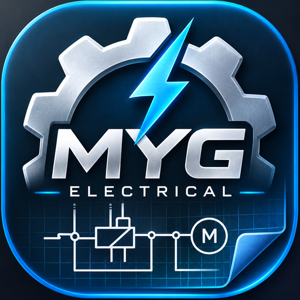
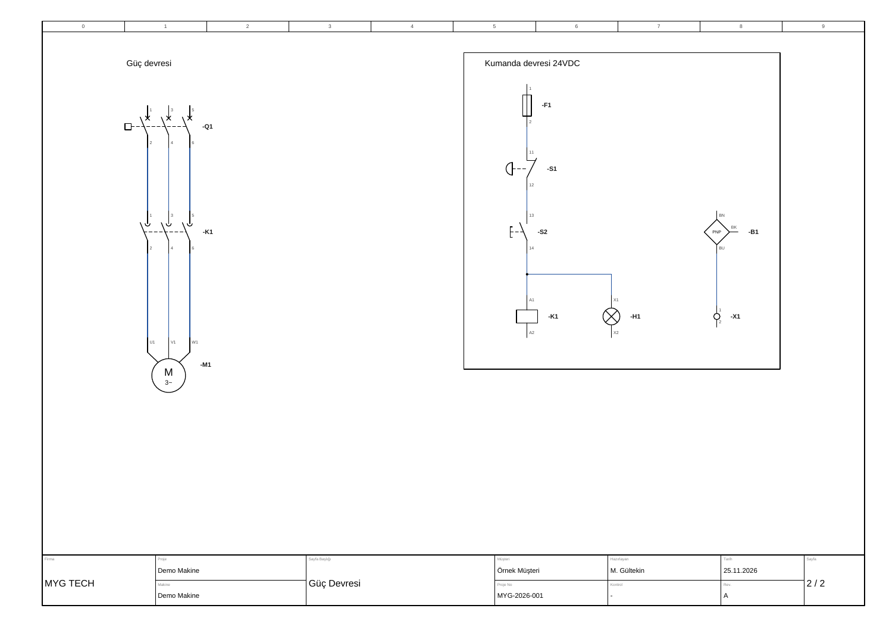
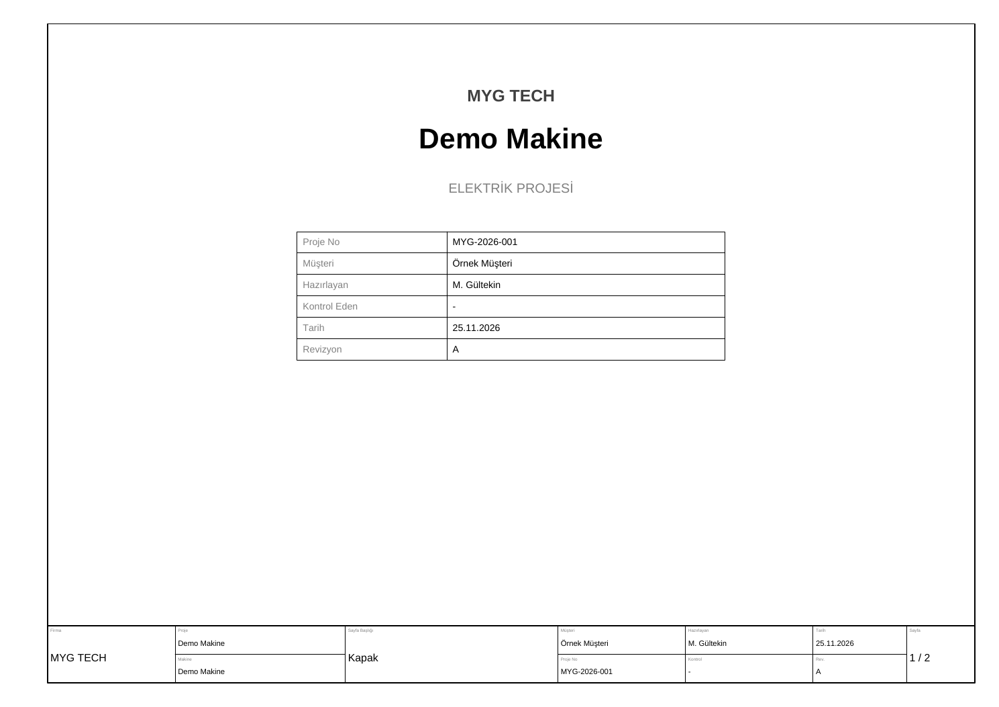

<div align="center">
  <a href="https://myusufgultekin.web.app/"></a>
  <p><a href="https://github.com/nicewo/MYG.Electrical/releases/latest"></a> <a href="https://github.com/nicewo/MYG.Electrical/actions/workflows/build.yml"></a> </p>
  <p><a href="https://myusufgultekin.web.app/">MYG TECH</a> · <a href="https://github.com/nicewo">GitHub Profile</a></p>
</div>

---

<p align="center">
  
</p>

<h1 align="center">MYG Electrical</h1>

<p align="center">
  <b>Makine imalatı için Windows tabanlı IEC elektrik şeması çizim yazılımı</b><br>
  MYG Tech tarafından geliştirilmektedir.
</p>

<p align="center">
  <a href="https://github.com/nicewo/MYG.Electrical/releases/latest"></a>
  <a href="https://github.com/nicewo/MYG.Electrical/actions/workflows/build.yml"></a>
  
  
</p>

<p align="center">
  <a href="https://github.com/nicewo/MYG.Electrical/releases/latest"><b>⬇ İndir (Setup.exe)</b></a> ·
  <a href="docs/KullanimKilavuzu.md">Kullanım kılavuzu</a> ·
  <a href="docs/KlavyeKisayollari.md">Kısayollar</a> ·
  <a href="https://myusufgultekin.web.app/">MYG Tech</a>
</p>

---

## MYG Electrical nedir?

MYG Electrical, makine imalatında kullanılan **kumanda ve güç devrelerini** çizmek, proje kapağı ve antetli
teknik sayfalar hazırlamak, çok sayfalı projeleri yönetmek ve **vektörel PDF** almak için geliştirilmiş,
sade ve hızlı bir Windows masaüstü uygulamasıdır.

EPLAN gibi büyük paketlerin tamamını kopyalamayı hedeflemez. Odak noktası, sahada ve atölyede en sık ihtiyaç
duyulan işi — IEC sembolleriyle temiz, okunur ve ölçekli bir şema çıkarmayı — az tıklamayla yapmaktır.
Öne çıkan özelliği, hizalanan cihazların pinlerini kendiliğinden bağlayan **geometrik otomatik kablolama**dır.

### Hangi ihtiyacı karşılar?

- Küçük ve orta ölçekli makine projelerinde, ağır bir CAD lisansı olmadan **hızlı şema** çıkarmak
- Pano imalatı ve servis için **antetli, sayfa numaralı, ölçekli PDF** üretmek
- Proje dosyasını **tek dosyada** (resimler dahil) taşımak, arşivlemek ve paylaşmak

### Kimler için?

Makine imalatçıları, pano üreticileri, otomasyon ve bakım teknisyenleri, elektrik-elektronik ve mekatronik
mühendisleri, teknik eğitim veren kurumlar ve öğrenciler.

## Ekran görüntüleri

Aşağıdaki görüntüler programın kendi ürettiği PDF çıktısıdır (`samples/Demo.myge`):

| Şema sayfası | Kapak sayfası |
|---|---|
|  |  |

## Temel özellikler (v0.2)

### Çizim
- Gerçek ölçü birimi **milimetre**; A4, A3, A2, A1 — yatay ve dikey
- 5 mm grid ve snap, imlece göre zoom, orta tuşla kaydırma
- Çizgi, dikdörtgen, metin; seçim, çoklu seçim, alan seçimi, sürükle-taşı, 90° döndürme
- Kes / kopyala / yapıştır, ok tuşlarıyla hassas kaydırma, sağ tık menüsü
- Sayfa işlemleri dahil **tam geri al / ileri al**

### Sembol kütüphanesi
IEC 60617 esinli yerleşik semboller: kontaktör (3 kutup), otomatik sigorta (3 kutup), sigorta, motor (3 faz),
bobin, röle, açık (NO) ve kapalı (NC) kontak, buton, acil stop, limit switch, endüktif sensör (PNP),
sinyal lambası, klemens. Pinler 5 mm grid üzerindedir; kontaktör, sigorta ve motor faz aralıkları uyumludur.
Cihazlar otomatik tanım alır (`-K1`, `-Q1`, `-M1`…).

> Kütüphane bu sürümde sabittir; kullanıcı tanımlı sembol ve sembol editörü henüz yoktur
> (bkz. [Yol haritası](docs/Roadmap.md)).

### Otomatik kablolama
- Aynı hatta bulunan ve **birbirine bakan** pinler kendiliğinden düz kabloyla bağlanır
- **Karşılıklı en yakın pin** kuralı: araya giren uygun pin varsa uzaktaki pine kablo çekilmez
- Cihaz taşındıkça kablolar canlı güncellenir; kablolar dosyada saklanmaz, her seferinde yeniden üretilir
- EPLAN tarzı bağlantı noktaları: **dirsek** (90° dönüş), yönlü **T** ve bilerek seçilen **çapraz** düğüm;
  kesişen hatlar yanlışlıkla birleşmez
- Yerleştirirken dirsek/T yönü çevredeki pinlere göre otomatik önerilir

Ayrıntı: [docs/AutoWiring.md](docs/AutoWiring.md)

### Proje ve sayfa yönetimi
- Kapak ve şema sayfaları, sayfa ekleme/silme/sıralama
- Kapak sayfası ve düzenlenebilir antet: firma, logo, makine adı, proje no, müşteri, hazırlayan,
  kontrol eden, tarih, revizyon, sayfa `n / N`, 0–9 kolon numaraları
- `.myge` JSON proje dosyası; güvenli kayıt (doğrulama + `.bak` yedeği), açılışta onarım

### Görsel ekleme
- PNG, JPG, BMP, GIF, TIFF; resim **proje dosyasına gömülür**
- Renk seçici ile **saydamlık** ve 0–100 **hassasiyet** (yakın renkleri de siler); PDF'te de saydam

### PDF çıktısı
- Tek sayfa veya tüm proje, **vektörel** (ekran görüntüsü değil), gerçek kağıt ölçüsünde
- Kapak ve antet dahil; sayfa dışına taşan nesneler için uyarı

### Kurulum ve otomatik güncelleme
- GitHub Releases üzerinden **Setup.exe** veya **Portable.zip**; .NET kurulumu gerekmez
- Açılışta yeni sürüm denetimi, arka planda (yalnızca değişen kısmı) indirme, onaylı yeniden başlatma

## Sistem gereksinimleri

| | |
|---|---|
| İşletim sistemi | Windows 10 veya 11, 64 bit |
| Disk | yaklaşık 250 MB |
| Ekran | en az 1280×720 önerilir |
| .NET | gerekmez (pakete dahil) |
| İnternet | yalnızca güncelleme denetimi için; çevrimdışı çalışır |

## İndir ve kur

1. **[Son sürüm](https://github.com/nicewo/MYG.Electrical/releases/latest)** sayfasından
   `MYG.Electrical-win-Setup.exe` dosyasını indirip çalıştırın. Yönetici izni gerekmez
   (`%LocalAppData%\MYG.Electrical` altına kurulur).
2. Program imzasız olduğu için Windows SmartScreen uyarı verebilir: **Ek bilgi → Yine de çalıştır**.
3. Kurulumsuz kullanım için `MYG.Electrical-win-Portable.zip`.

Program açılışta internet varsa güncellemeyi kendisi denetler. Elle: **Yardım → Güncellemeleri denetle**.

## Örnek proje

Programda **Yardım → Örnek projeyi aç**, ya da depodaki [`samples/Demo.myge`](samples/Demo.myge):
direkt yol verme güç devresi (Q1 → K1 → M1) ve 24 VDC kumanda devresi (F1, acil stop, start butonu,
T ve dirsekle dallanan bobin/lamba hattı, PNP sensör).

## Geliştirme mimarisi

```
src/
  MYG.Electrical.App             WPF arayüz (MVVM), güncelleme, Hakkında
  MYG.Electrical.Core            Model, geometri, AutoWireEngine, düzenleme oturumu, sahne kompozisyonu (WPF bağımsız)
  MYG.Electrical.Drawing         DrawingVisual tabanlı çizim alanı ve WPF renderer
  MYG.Electrical.Symbols         Yerleşik IEC sembol kütüphanesi
  MYG.Electrical.Infrastructure  .myge kayıt/açma, PDF (PDFsharp), log (Serilog)
tests/                           xUnit v3 — Core, serileştirme/PDF, WPF renderer
docs/                            Mimari, proje formatı, otomatik kablolama, kılavuz, yol haritası
```

- C# / .NET 10 / WPF, MVVM; Core katmanı WPF'e bağımlı değildir
- Ekran ve PDF aynı sahne kompozisyonunu kullanır (`ISceneSink`), bu yüzden çıktı ekranla aynıdır
- Her push'ta GitHub Actions derler ve 180+ testi çalıştırır; `main`'de uygulama dosyaları (src/, samples/,
  derleme ayarları) değiştiyse paketleyip Release yayınlar (Velopack). Yalnızca belge/görsel değişikliğinde
  release çıkmaz; gerekirse Actions → build → *Run workflow* ile elle yayınlanır.

Kaynaktan derleme (Windows, [.NET 10 SDK](https://dotnet.microsoft.com/download/dotnet/10.0)):

```powershell
git clone https://github.com/nicewo/MYG.Electrical.git
cd MYG.Electrical
dotnet build
dotnet test --solution MYG.Electrical.slnx
dotnet run --project src/MYG.Electrical.App
```

Ayrıntılı belgeler: [Mimari](docs/Architecture.md) · [Proje formatı](docs/ProjectFormat.md) ·
[Otomatik kablolama](docs/AutoWiring.md) · [Son inceleme raporu](docs/Review-2026-11-25.md)

## Yol haritası

Planlanan başlıca konular (henüz **yok**): kullanıcı tanımlı semboller ve sembol editörü, kapsamlı sembol
envanteri, potansiyel ve kablo numaralandırma, kontak–bobin çapraz referansları, klemens planı, kablo ve
bağlantı listeleri, sayfalar arası referanslar, L/Z kablo yönlendirme, yazdırma.
Güncel liste: [docs/Roadmap.md](docs/Roadmap.md).

## Geliştirici

**MYG Electrical**, MYG Tech bünyesinde bağımsız olarak geliştirilen bir yazılım ürünüdür.

**Muhammed Yusuf Gültekin** — Software & Electronics Engineer
🌐 [myusufgultekin.web.app](https://myusufgultekin.web.app/) · GitHub: [@nicewo](https://github.com/nicewo)

## İletişim ve katkı

- Hata bildirimi ve öneriler: [GitHub Issues](https://github.com/nicewo/MYG.Electrical/issues)
  (mümkünse **Araçlar → Log klasörünü aç** ile son log dosyasını ekleyin)
- Kod katkısı için önce bir issue açıp konuyu konuşalım; ardından pull request gönderebilirsiniz.
  Pull request'lerde derleme ve testler otomatik çalışır.

## Lisans

MYG Electrical **ücretsiz** indirilip kullanılabilir ve kaynak kodu herkese açıktır. Ancak **henüz bir açık
kaynak lisansı seçilmemiştir**: depoda `LICENSE` dosyası yayımlanana kadar kodun kopyalanması,
değiştirilmesi ve yeniden dağıtılması için geliştiricinin izni gerekir.

Kullanılan üçüncü taraf bileşenler ve lisansları: [THIRD-PARTY-NOTICES.md](THIRD-PARTY-NOTICES.md).

© MYG Tech — Muhammed Yusuf Gültekin
